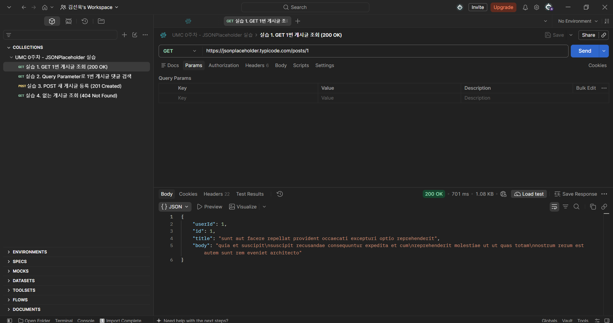
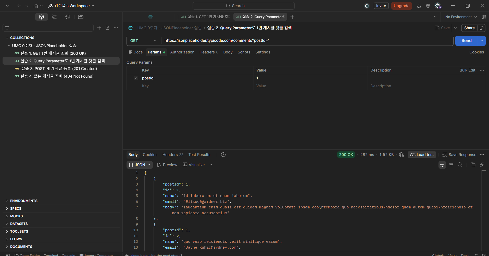
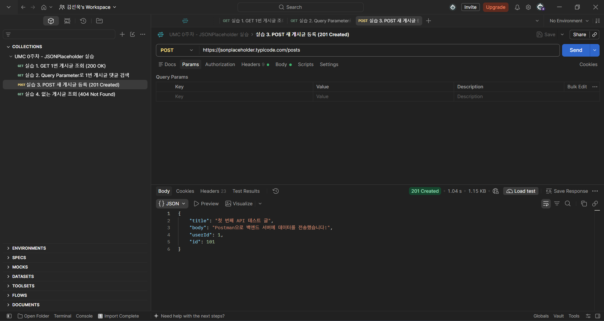
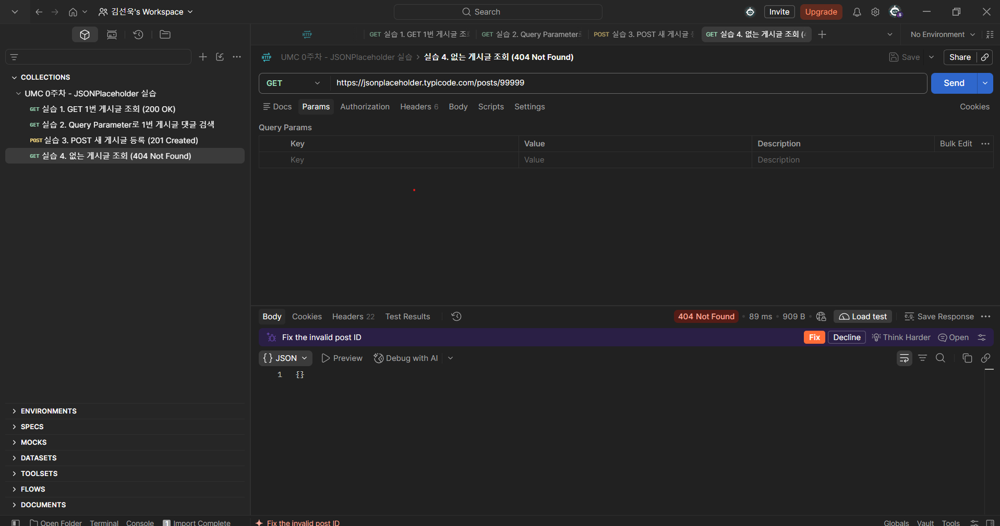

# 0주차 캡처 체크리스트

Postman → Import → `week00-postman/jsonplaceholder.postman_collection.json` → 요청마다 Send.
URL, Method, Status Code, 응답 JSON이 한 화면에 보이게 찍은 캡처.

| 파일 이름 | 무엇을 찍나 | 상태 |
|---|---|---|
| `01-get-post.png` | 실습 1. `GET /posts/1` → 200 OK | ✅ |
| `02-query-param.png` | 실습 2. `GET /comments?postId=1` → Params 탭과 결과 배열 | ✅ |
| `03-post-created.png` | 실습 3. `POST /posts` → 201 Created, `id: 101` | ✅ |
| `04-not-found.png` | 실습 4. `GET /posts/99999` → 404 Not Found | ✅ |

## 미리보기

### 실습 1. GET 1번 게시글 조회 (200 OK)

### 실습 2. Query Parameter로 댓글 검색 (200 OK)

### 실습 3. POST 새 게시글 등록 (201 Created)

### 실습 4. 없는 게시글 조회 (404 Not Found)

