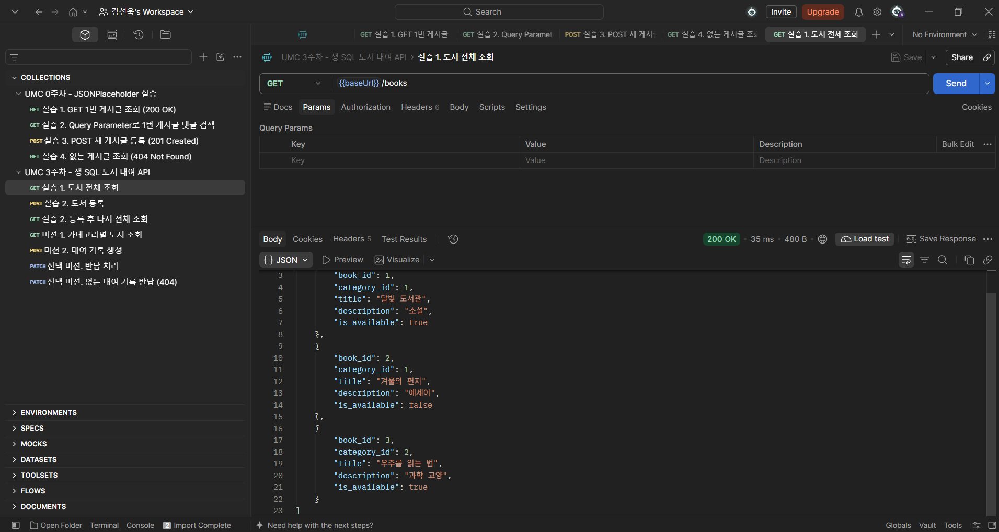
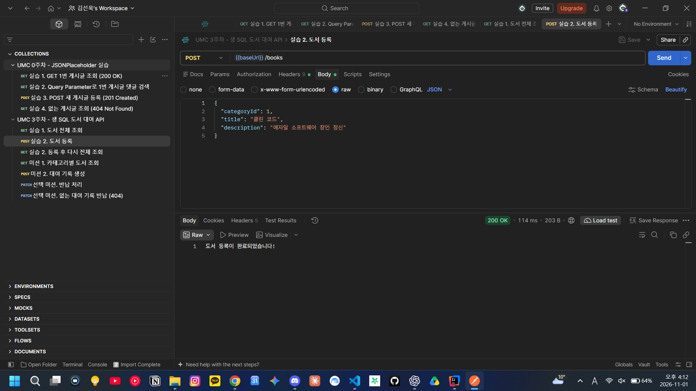
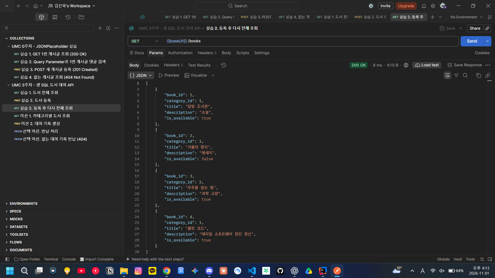
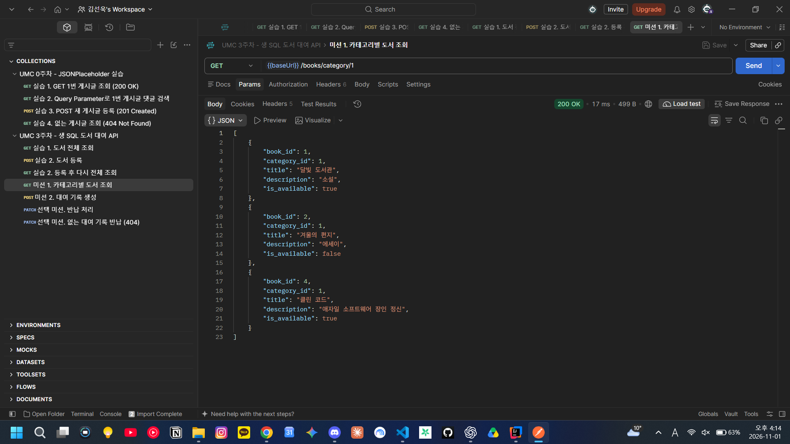
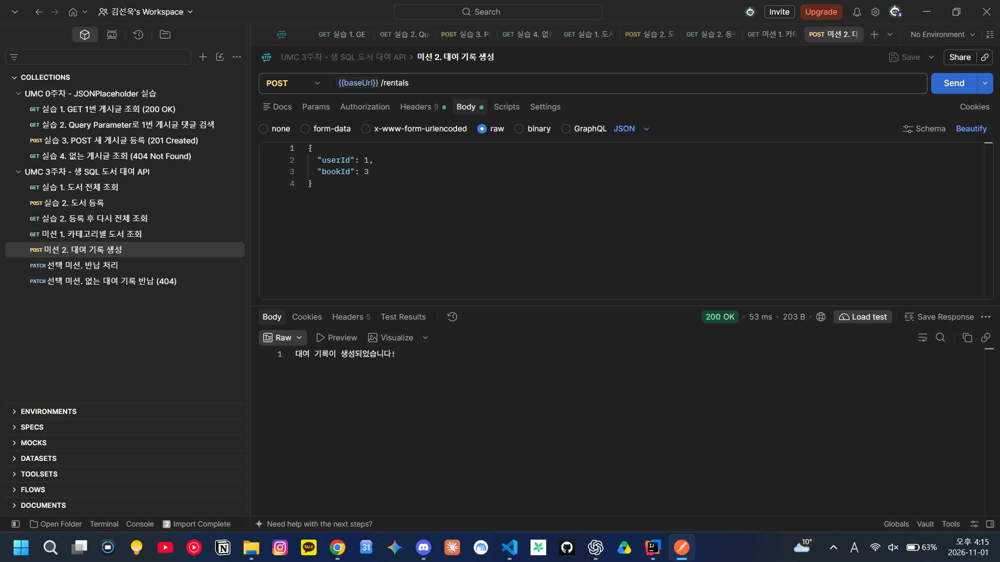
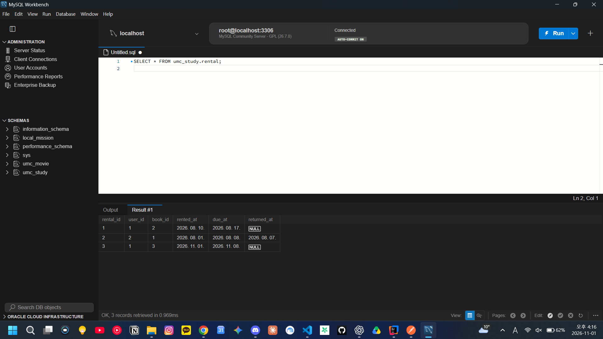
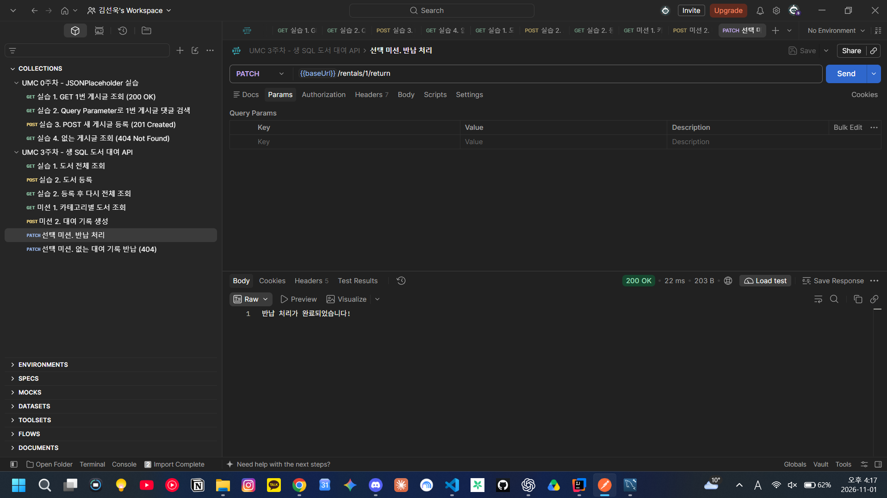
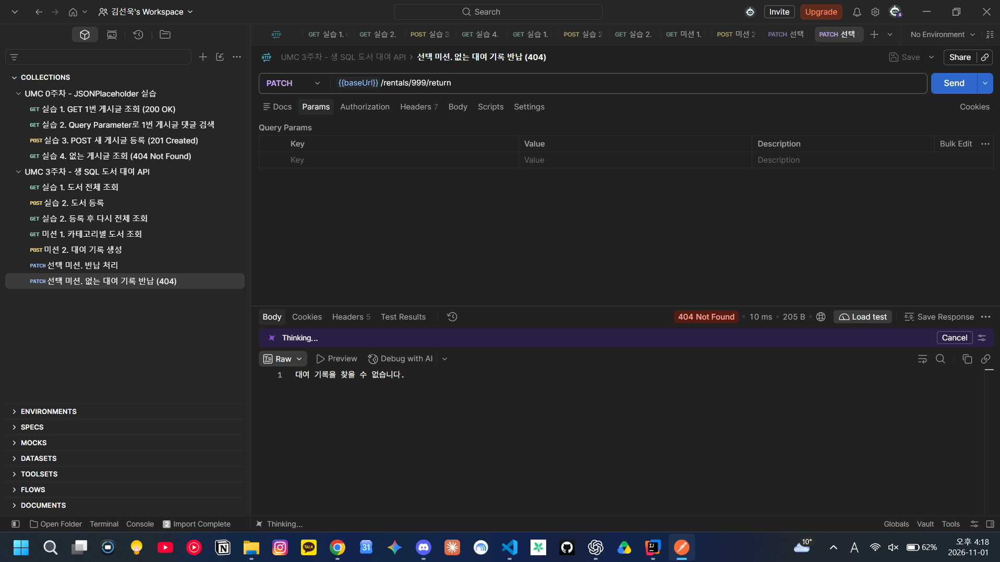
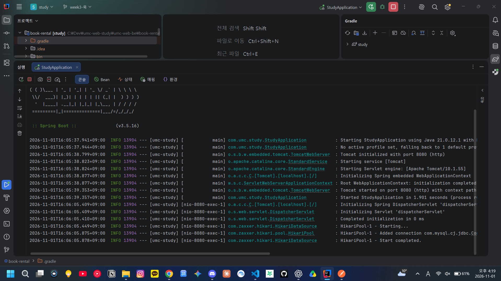

# 3주차 캡처 체크리스트

MySQL `umc_study`(2주차 SQL) + `StudyApplication` 실행 후 Postman `book-rental/postman/week03.postman_collection.json` 요청을 순서대로 보낸 캡처.

| 파일 이름 | 무엇을 찍나 | 상태 |
|---|---|---|
| `01-get-books.png` | 실습 1. `GET /books` → 200, 책 3권 | ✅ |
| `02-post-book.png` | 실습 2. `POST /books` → Body + "도서 등록이 완료되었습니다!" | ✅ |
| `03-get-books-after.png` | 실습 2. 다시 `GET /books` → 맨 끝에 "클린 코드" | ✅ |
| `04-mission-category.png` | 미션 1. `GET /books/category/1` → 문학 책만 | ✅ |
| `05-mission-rental.png` | 미션 2. `POST /rentals` → "대여 기록이 생성되었습니다!" | ✅ |
| `06-mission-rental-db.png` | 미션 2. Workbench `SELECT * FROM rental;` → 새 행 `due_at`이 7일 뒤 | ✅ |
| `07-return.png` | 선택 미션. `PATCH /rentals/1/return` → 200 | ✅ |
| `08-return-404.png` | 선택 미션. `PATCH /rentals/999/return` → 404 | ✅ |
| `09-intellij-run.png` | IntelliJ 콘솔 `Started StudyApplication`, HikariPool 연결 | ✅ |

## 미리보기

### 실습 1. 도서 전체 조회

### 실습 2. 도서 등록

### 실습 2. 등록 후 다시 조회

### 미션 1. 카테고리별 도서 조회

### 미션 2. 대여 기록 생성

### 미션 2. DB에서 반납 예정일 확인

### 선택 미션. 반납 처리 / 없는 대여 기록

### 서버 실행 로그

