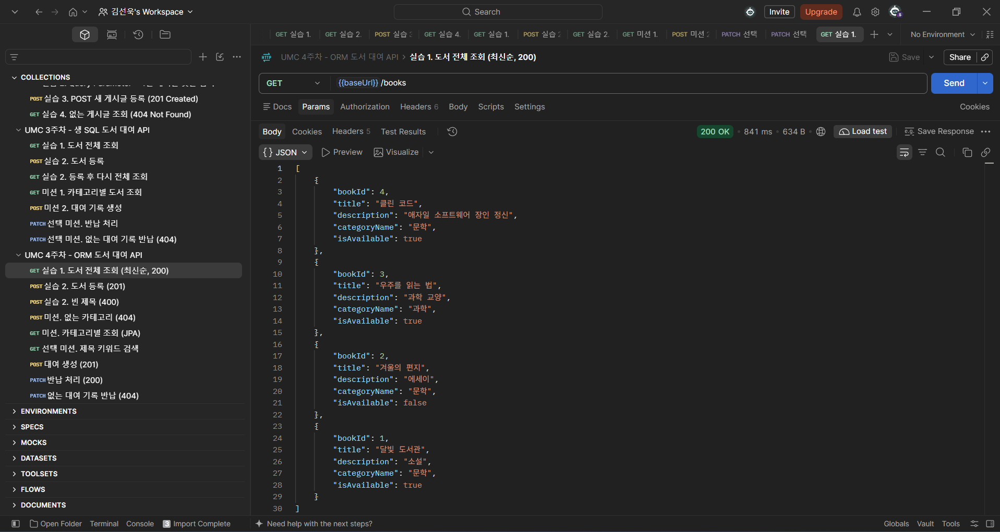
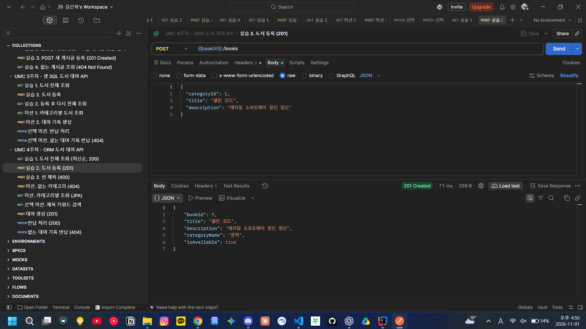
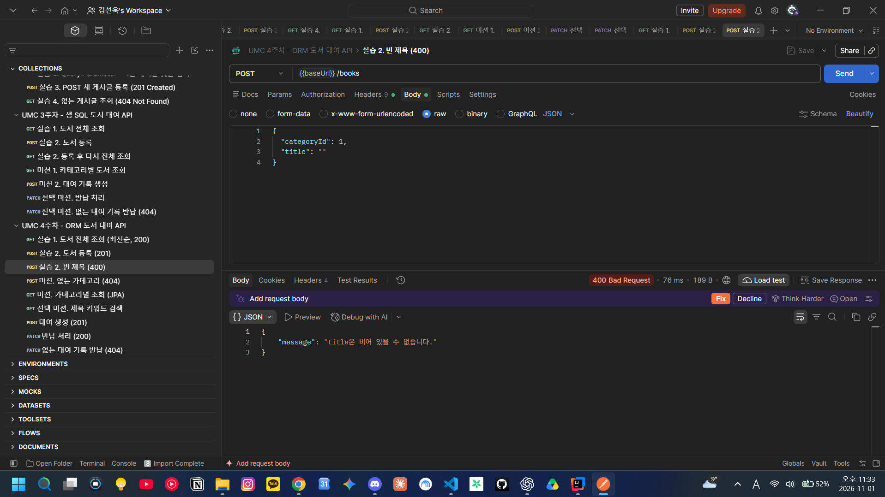
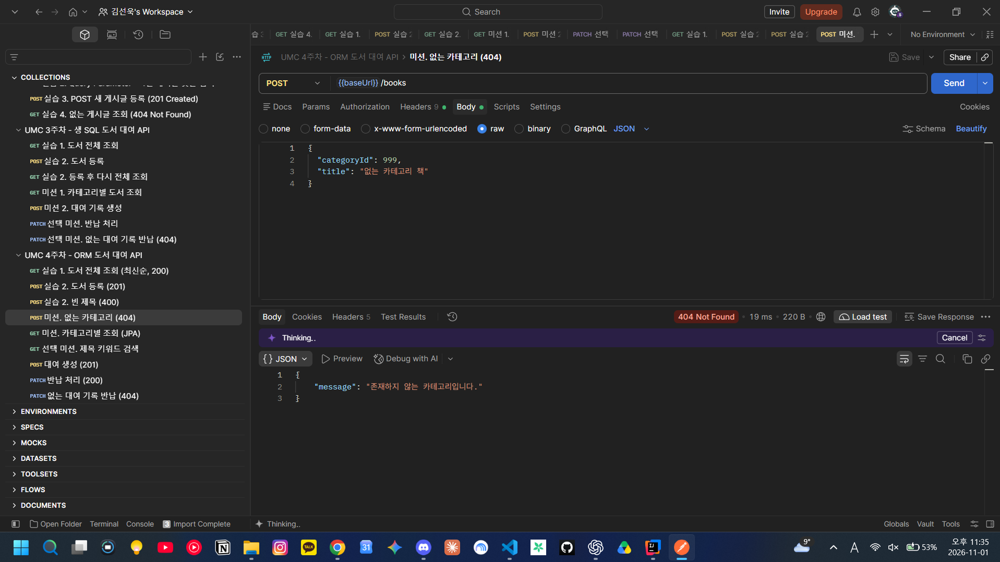
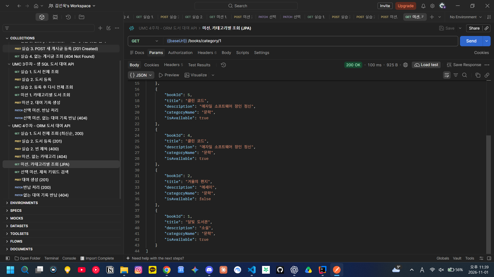
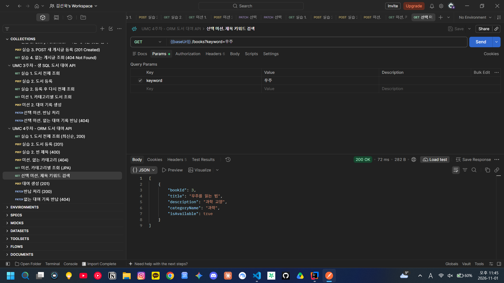
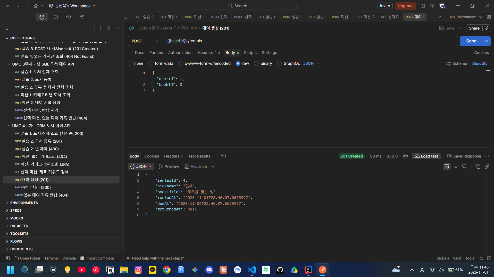
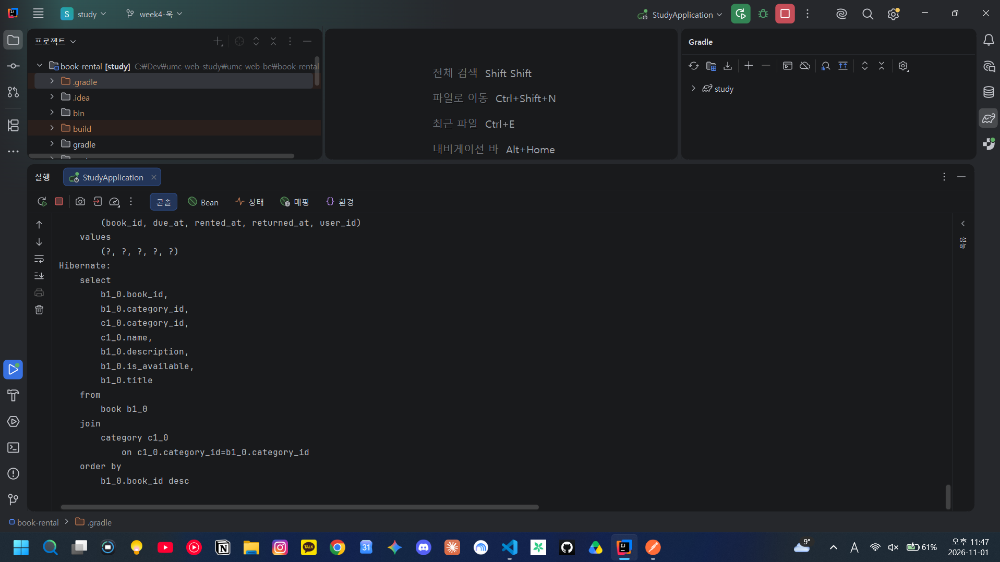

# 4주차 캡처 체크리스트

준비: 3주차와 같은 DB(`umc_study`)와 환경 변수로 `StudyApplication` 실행 → Postman에서 `book-rental/postman/week04.postman_collection.json` Import.

| 파일 이름 | 무엇을 찍나 | 상태 |
|---|---|---|
| `01-get-books.png` | `GET /books` → 200, 최신순 + `bookId`, `categoryName`, `isAvailable` | ✅ |
| `02-post-201.png` | `POST /books` → **201 Created** + 응답 DTO | ✅ |
| `03-post-400.png` | 빈 제목 → **400** `{"message": "title은 비어 있을 수 없습니다."}` | ✅ |
| `04-post-404.png` | 없는 카테고리 → **404** `{"message": "존재하지 않는 카테고리입니다."}` | ✅ |
| `05-category.png` | `GET /books/category/1` → 문학 책만 | ✅ |
| `06-keyword.png` | (선택) `GET /books?keyword=우주` | ✅ |
| `07-rental.png` | `POST /rentals` → 201, `dueAt`이 `rentedAt` 7일 뒤 | ✅ |
| `08-sql-log.png` | IntelliJ 콘솔에서 `show-sql`로 찍힌 `select ... join category ... order by book_id desc` | ✅ |

## 미리보기

### 실습 1. 도서 전체 조회 (최신순 DTO)

### 실습 2. 도서 등록 (201)

### 실습 2. 빈 제목 (400)

### 미션. 없는 카테고리 (404)

### 미션. 카테고리별 조회 (JPA)

### 선택 미션. 제목 키워드 검색

### 대여 생성 (201, 반납 예정일 7일 뒤)

### JPA가 만든 SQL 로그

