# 6주차 캡처 체크리스트

워크북 넣을 곳: **실습 인증** = 3장(회원가입 성공·검증 실패·평점 등록/수정 성공), **미션 기록** = 중간 과정 + Postman 요청/응답 전부, **트러블 슈팅** = 에러가 났을 때.

| 파일 이름 | 무엇을 찍나 | 워크북 위치 | 상태 |
|---|---|---|---|
| `01-gradle-crypto-started.png` | 1단계. `build.gradle`에 `spring-security-crypto` 추가 후 IntelliJ 실행 → `Started MovieApplication` | 미션 기록 (중간 과정) | ✅ |
| `02-password-config-commit.png` | 1단계. `PasswordConfig` 추가 후 `git status`·커밋 (`369cca3`) | 미션 기록 (중간 과정) | ✅ |
| `03-api-response-status.png` | 2단계. `ApiResponse` 추가 후 `git status` (스테이징 확인) | 미션 기록 (중간 과정) | ✅ |
| `04-signup-201.png` | 4단계. `POST /members` 정상 → 201 `COMMON201`, `memberId: 3`, 응답에 password 없음 | 실습 인증 ① | ✅ |
| `05-signup-400.png` | 5단계. 비밀번호 규칙 위반 → 400 `COMMON4001`, "비밀번호는 대문자/소문자/숫자/특수문자를 포함한 8자 이상이어야 합니다." | 실습 인증 ② | ✅ |
| `06-signup-409.png` | 5단계. 이미 쓰는 이메일 `umc@example.com` 재가입 → 409 `COMMON4092`, "이미 사용 중인 이메일입니다." | 미션 기록 | ✅ |
| `07-db-password-hash.png` | DB `member` 테이블에서 password가 `$2a$...` 해시로 저장됨 | 미션 기록 | |
| `08-rating-201.png` | 7단계. `POST /members/1/ratings` 평점 등록 → 201 `COMMON201`, `result: 4`(새 ratingId) | 실습 인증 ③ | ✅ |
| `09-rating-409.png` | 7단계. 같은 회원·영화로 다시 등록 → 409 `COMMON4092`, "이미 이 영화에 평점을 남기셨습니다." | 미션 기록 | ✅ |
| `10-rating-400.png` | 7단계. 별점 범위 밖 → 400 `COMMON4001`, "별점은 5점 이하여야 합니다." | 미션 기록 | ✅ |
| `11-rating-patch-200.png` | 7단계. `PATCH /members/1/ratings/4` 수정 → 200 `COMMON200`, "평점 수정에 성공했습니다." | 미션 기록 | ✅ |
| `12-rating-delete-204.png` | 7단계. `DELETE /members/1/ratings/4` → 204 No Content, 본문 없음 | 미션 기록 | ✅ |
| `13-rating-404.png` | 7단계. 이미 지운 ratingId 4를 다시 `DELETE` → 404 `COMMON404`, "존재하지 않는 평점입니다." | 미션 기록 | ✅ |
| `14-rating-403.png` | 7단계. `PATCH /members/2/ratings/4` (회원 1의 평점을 회원 2가 수정) → 403 `COMMON403`, "본인이 작성한 평점만 수정하거나 삭제할 수 있습니다." | 미션 기록 | ✅ |
| `16-rating-get-after-patch.png` | 7단계. 수정 후 `GET /members/1/ratings` → ratingId 4가 `score 3`, "다시 보니 보통", `updatedAt`(18:40:41)이 `createdAt`(18:24:24)보다 늦음 → `save()` 없이 변경 감지로 UPDATE 확인 | 미션 기록 | ✅ |
| `15-troubleshoot-filename.png` | 5단계 트러블슈팅. 파일 이름을 `GlobalExceptionHandle.java`(r 빠짐)로 만들어 `class GlobalExceptionHandler is public, should be declared in a file named GlobalExceptionHandler.java` 빌드 실패 | 트러블 슈팅 | ✅ |

## 미리보기

### 1단계. crypto 의존성 추가 후 서버 실행
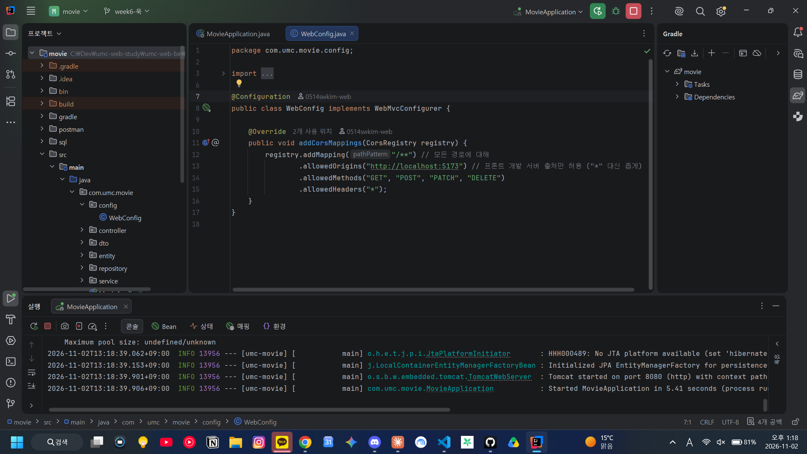

### 1단계. PasswordConfig 커밋
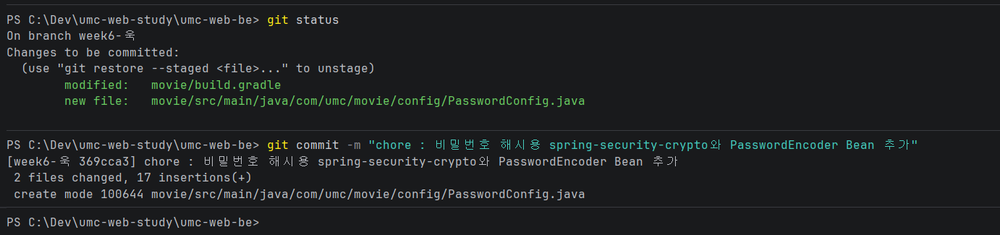

### 2단계. ApiResponse 스테이징 확인
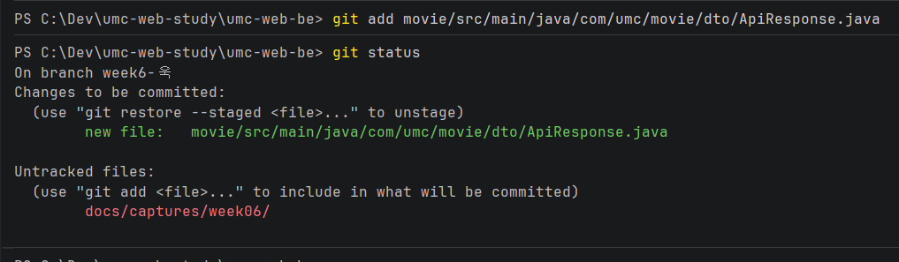

### 4단계. 회원가입 성공 (201) — 실습 인증 ①
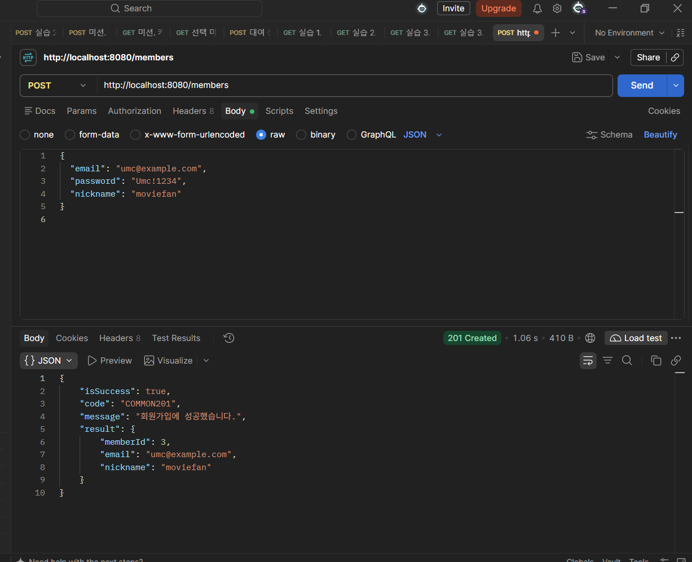

### 5단계. 회원가입 검증 실패 (400) — 실습 인증 ②
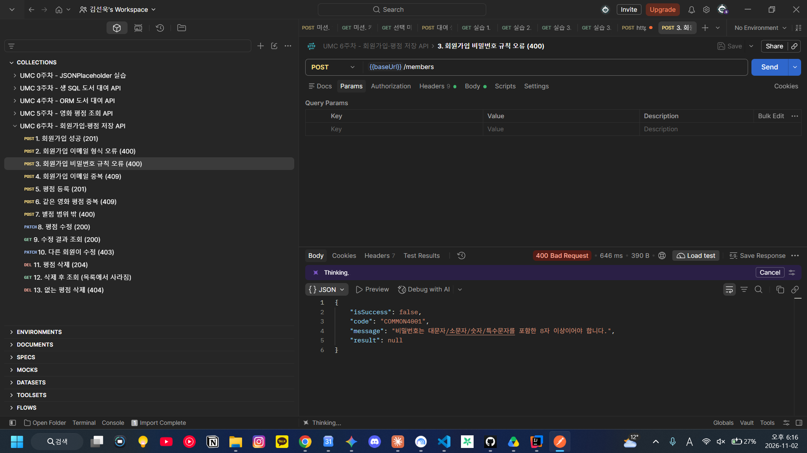

### 5단계. 이메일 중복 (409)
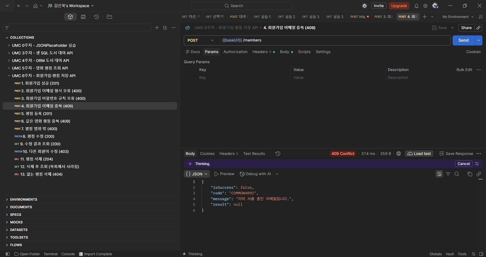

### 7단계. 평점 등록 (201) — 실습 인증 ③
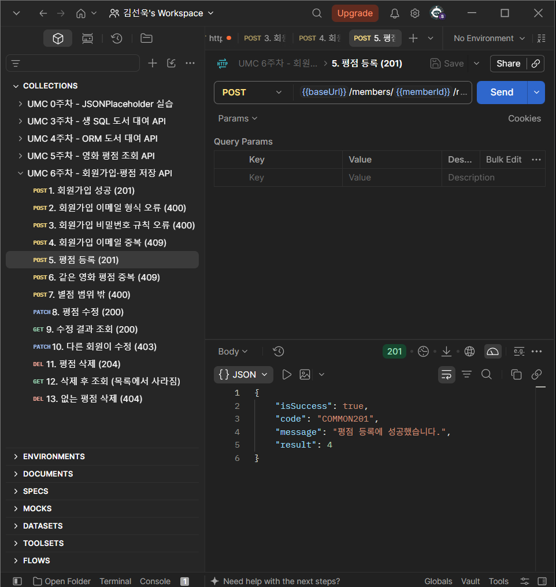

### 7단계. 같은 영화 평점 중복 (409)
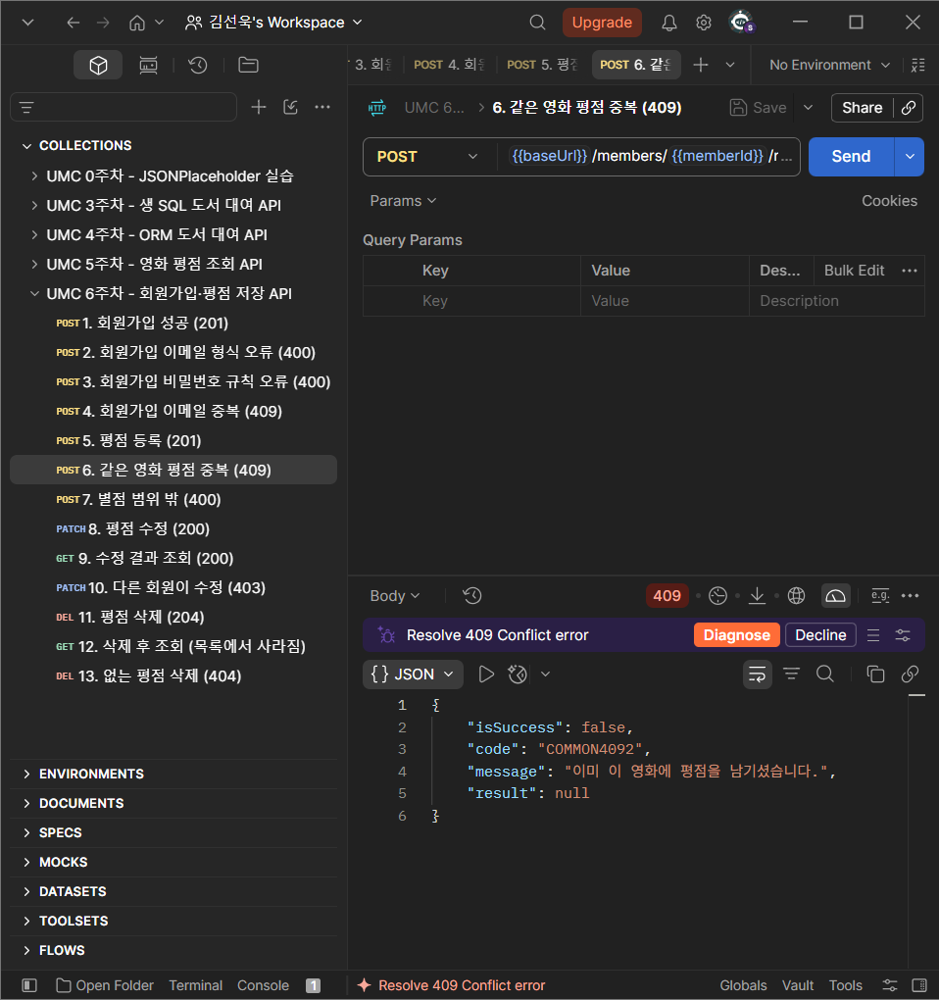

### 7단계. 별점 범위 밖 (400)
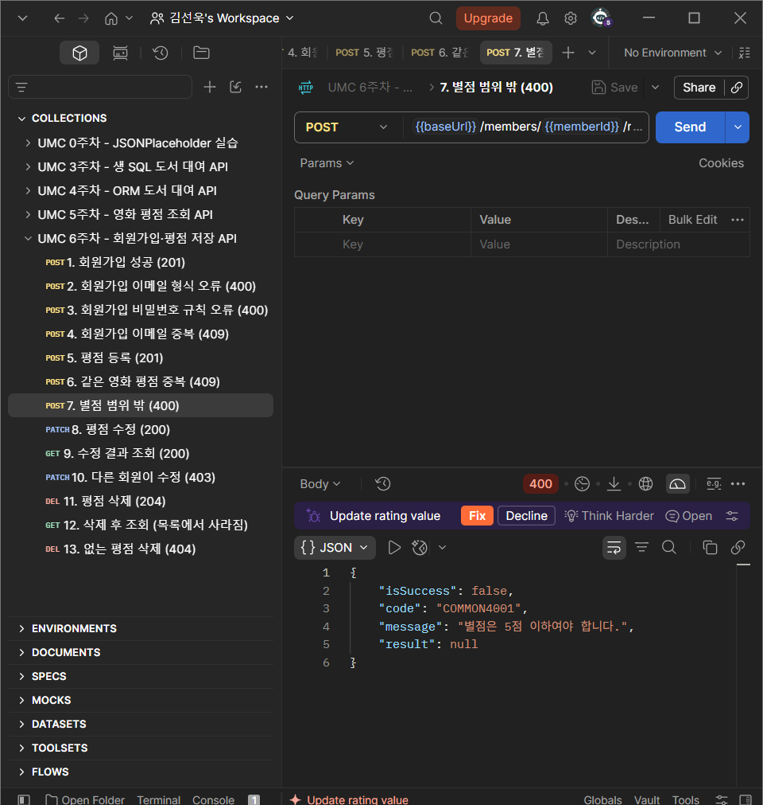

### 7단계. 평점 수정 (200)
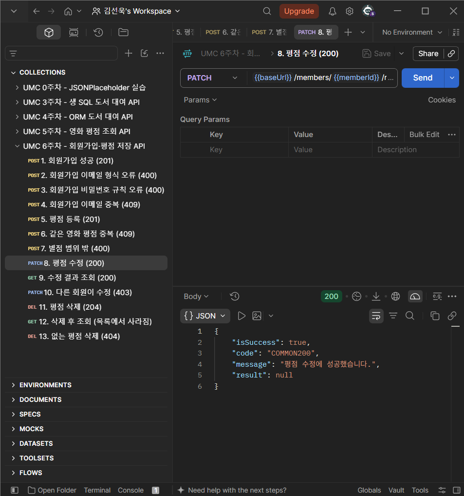

### 7단계. 수정 결과 조회 — 변경 감지 확인
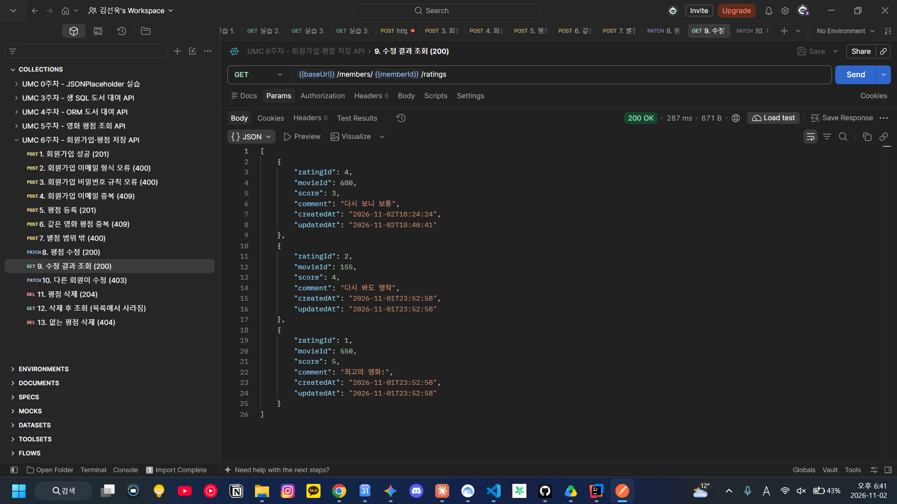

### 7단계. 다른 회원이 수정 (403)
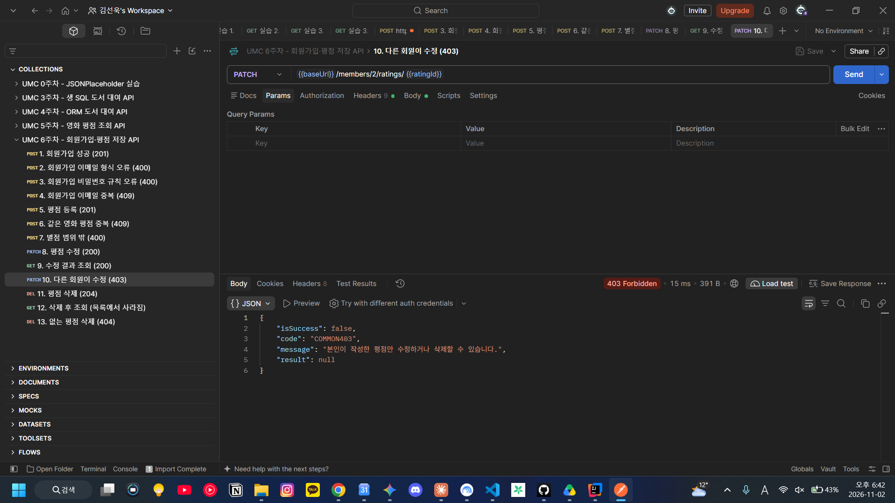

### 7단계. 평점 삭제 (204)
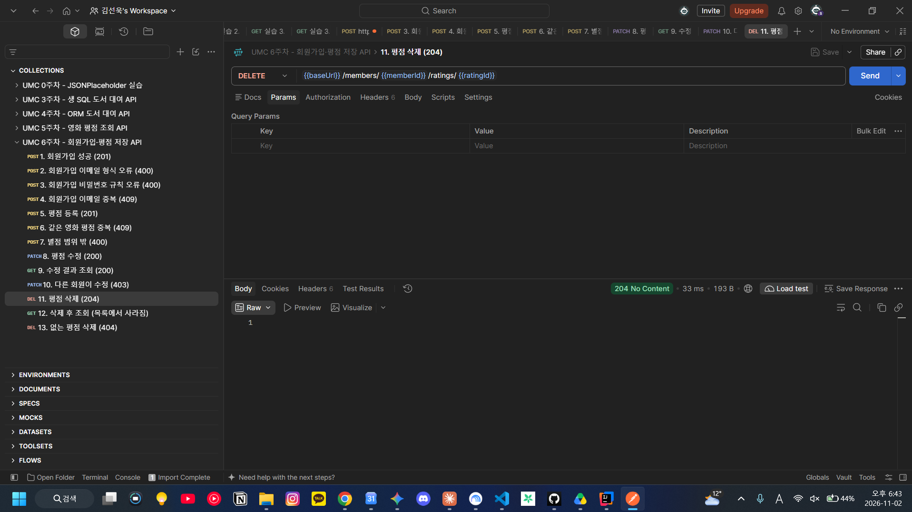

### 7단계. 없는 평점 삭제 (404)
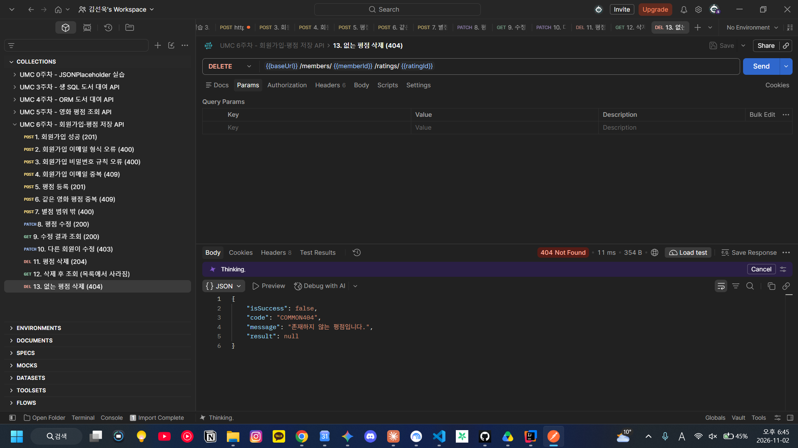

### 5단계 트러블슈팅. 파일 이름과 클래스 이름 불일치
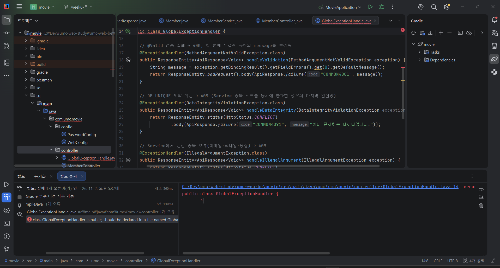
