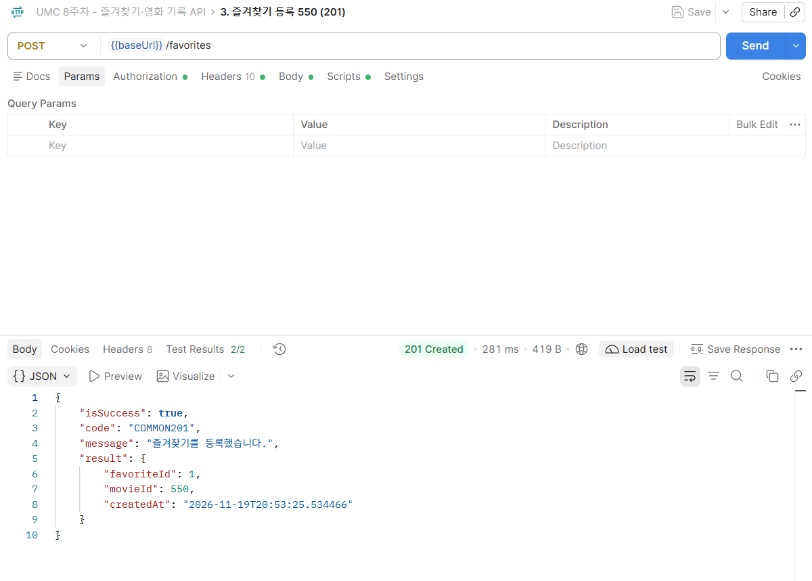
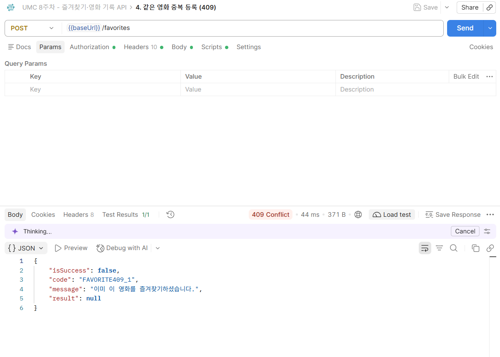
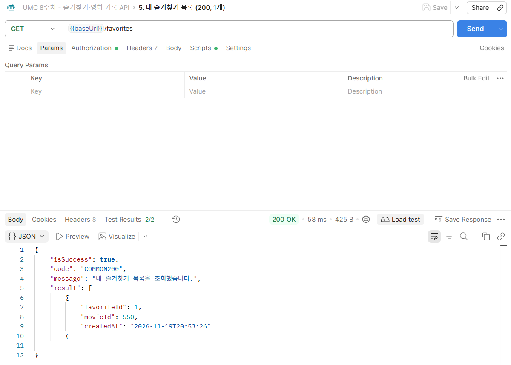
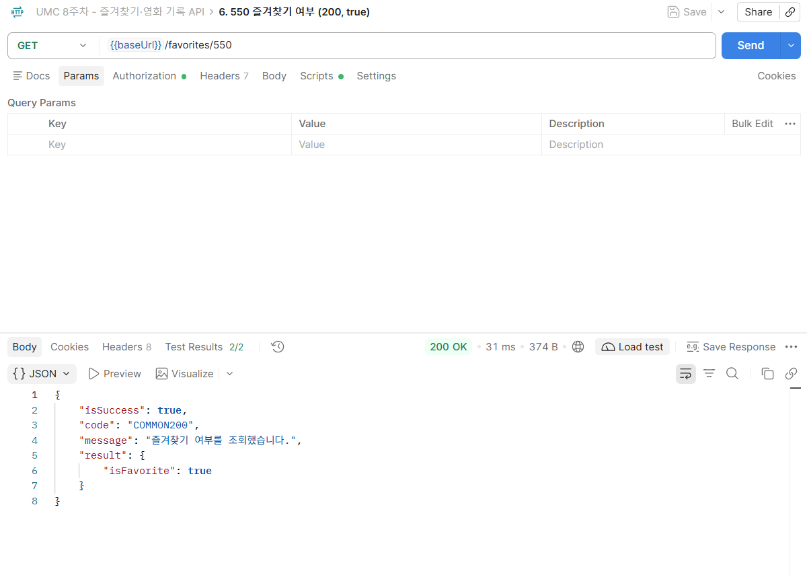
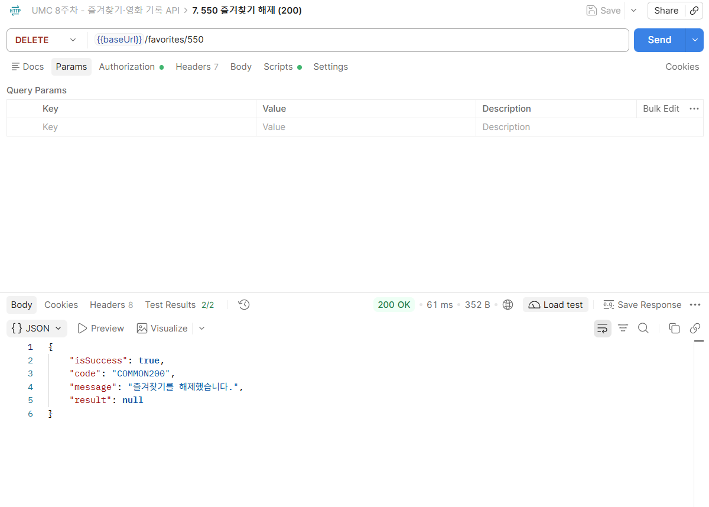
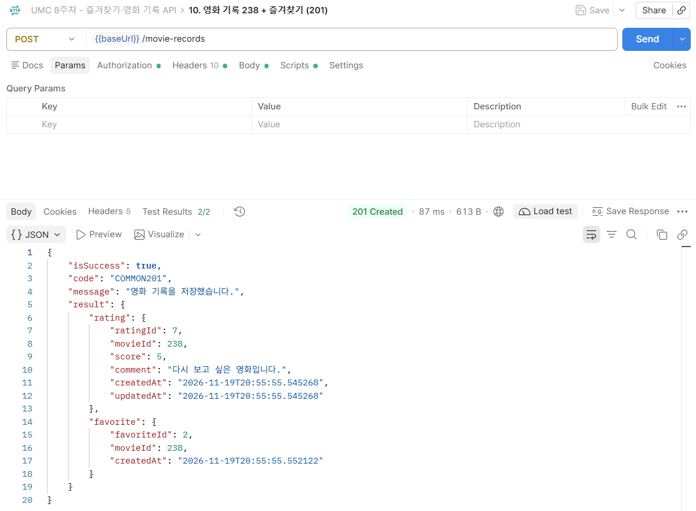
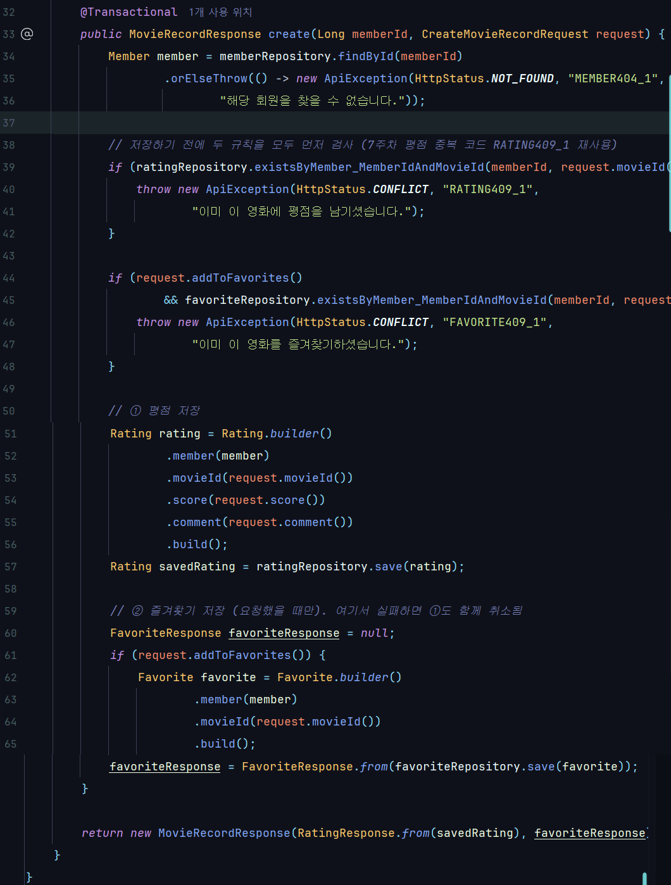

# 8주차 캡처 체크리스트

워크북 넣을 곳: **실습 인증** ①~④, **미션 기록**(필수 미션 제출물) = 즐겨찾기 4개 API 성공·`FAVORITE409_1`·영화 기록 성공.

Postman 컬렉션: [`movie/postman/week08.postman_collection.json`](../../../movie/postman/week08.postman_collection.json) (1번이 새 회원을 만들어서 1→16 반복 실행 가능)

| 파일 이름 | 무엇을 찍나 | 워크북 위치 | 상태 |
|---|---|---|---|
| `01-favorite-create-201.png` | Postman 3. `POST /favorites` `{ "movieId": 550 }` → 201 `COMMON201`, favoriteId 1 | 실습 인증 ① · 미션 | ✅ |
| `02-favorite-duplicate-409.png` | Postman 4. 같은 요청 다시 → 409 `FAVORITE409_1` "이미 이 영화를 즐겨찾기하셨습니다." | 실습 인증 ① · 미션 | ✅ |
| `03-favorite-list-200.png` | Postman 5. `GET /favorites` → 200, 내 즐겨찾기 1개 | 실습 인증 ② · 미션 | ✅ |
| `04-favorite-status-true.png` | Postman 6. `GET /favorites/550` → 200, `isFavorite: true` | 실습 인증 ② · 미션 | ✅ |
| `05-favorite-delete-200.png` | Postman 7. `DELETE /favorites/550` → 200, `result: null` | 실습 인증 ② · 미션 | ✅ |
| `06-movie-record-201.png` | Postman 10. `POST /movie-records` (238, 5점, `addToFavorites: true`) → 201, `rating`·`favorite` 함께 | 실습 인증 ③ · 미션 | ✅ |
| `07-movie-record-transactional-code.png` | `MovieRecordService.create()`의 `@Transactional` (IntelliJ 3장 이어 붙임) | 실습 인증 ④ | ✅ |

## 미리보기

### 즐겨찾기 등록 201

### 같은 영화 중복 등록 409

### 내 즐겨찾기 목록 200

### 즐겨찾기 여부 true

### 즐겨찾기 해제 200

### 영화 기록 201 (rating + favorite)

### @Transactional 코드

