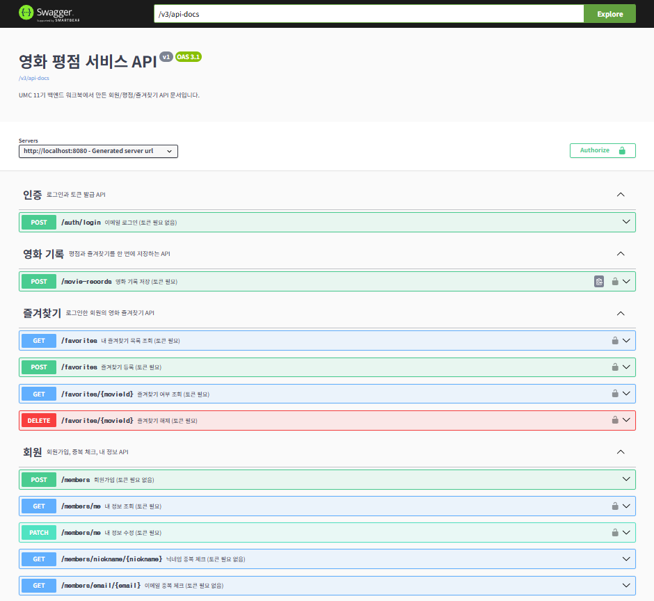
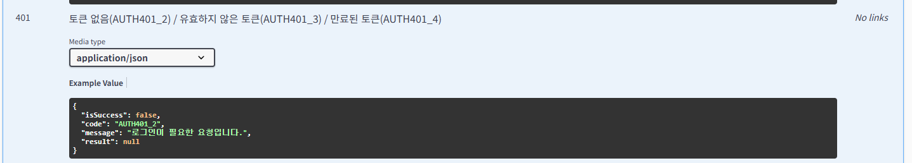
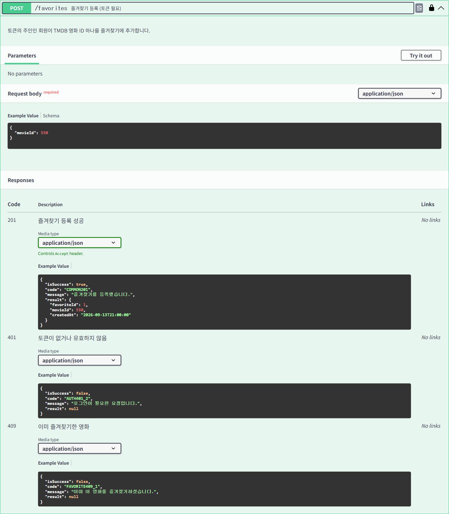
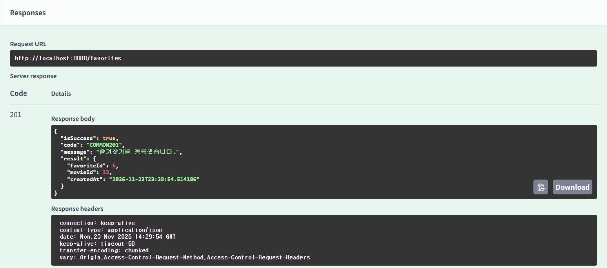
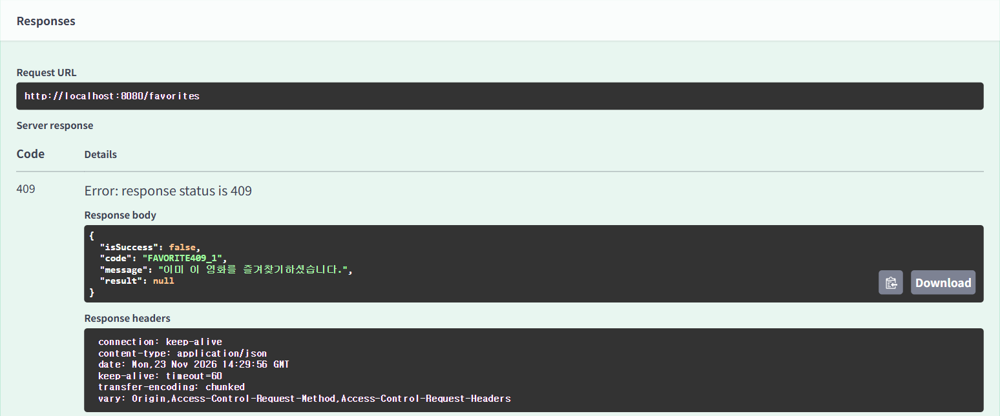
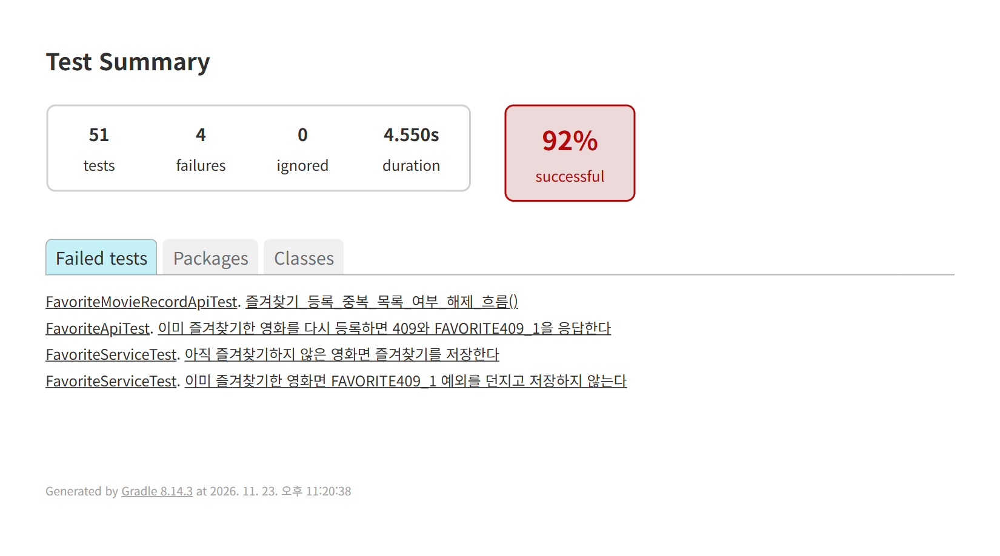
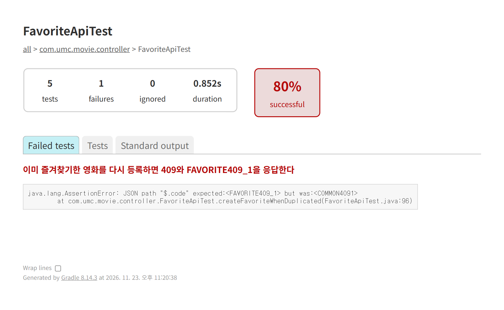
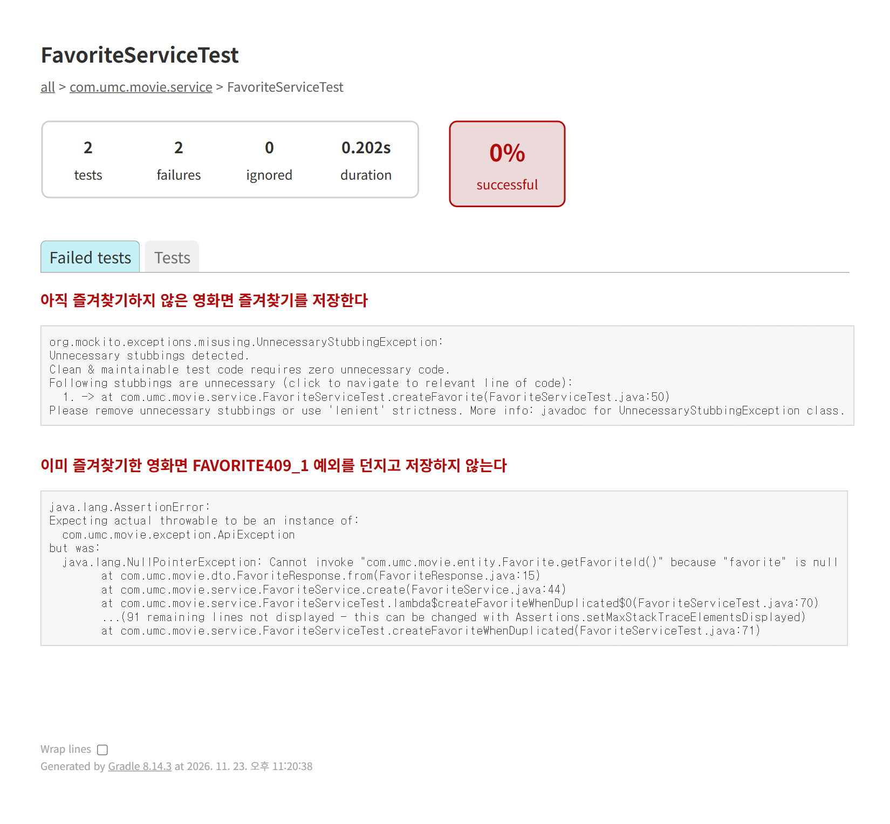

# 9주차 캡처 체크리스트

워크북 넣을 곳: **미션 기록**(필수 미션) = Swagger 문서 화면 + 테스트 전체 통과.

Swagger 주소: `http://localhost:8080/swagger-ui/index.html` (문서 JSON은 `/v3/api-docs`)

| 파일 이름 | 무엇을 찍나 | 노션 칸 | 상태 |
|---|---|---|---|
| `01-swagger-list.png` | Swagger 전체 목록. 토큰이 필요한 API에만 자물쇠, 로그인·회원가입·중복 체크는 자물쇠 없음 | BE 사진01 | ✅ |
| `02a-swagger-post-ratings.png` | `POST /ratings` 펼침. 한 줄 설명, Request body 예시, 201 `COMMON201` | BE 사진02 | ✅ |
| `02b-swagger-post-ratings-401.png` | 같은 API의 401 (`AUTH401_2`/`3`/`4`) 예시 | BE 사진02 | ✅ |
| `02c-swagger-post-ratings-409.png` | 같은 API의 409 `RATING409_1` 예시 | BE 사진02 | ✅ |
| `03a-swagger-members-me.png` | `GET /members/me` 펼침. `memberId` 입력칸 없음(`@Parameter(hidden = true)`), 200 응답 | BE 사진03 | ✅ |
| `03b-swagger-members-me-401.png` | 같은 API의 401 예시 | BE 사진03 | ✅ |
| `03c-swagger-delete-favorite.png` | `DELETE /favorites/{movieId}` 펼침. 입력칸은 `movieId` 하나 | BE 사진03 | ✅ |
| `03d-swagger-delete-favorite-404.png` | 같은 API의 404 `FAVORITE404_1` 예시 | BE 사진03 | ✅ |
| `04-test-pass.png` | IntelliJ `src/test` 전체 실행 → 51개 테스트 통과, BUILD SUCCESSFUL | BE 사진04 · 실습 인증 ③ | ✅ |
| `06a-swagger-post-favorites.png` | Authorize 후 `POST /favorites` 펼침 (자물쇠 잠김, 설명·201/401/409 예시) | 실습 인증 ① | ✅ |
| `06b-swagger-favorite-201.png` | Try it out `{ "movieId": 13 }` → 201 `COMMON201`, favoriteId 6 (curl 칸은 토큰이 보여서 숨김) | 실습 인증 ② | ✅ |
| `06c-swagger-favorite-409.png` | 같은 요청 한 번 더 → 409 `FAVORITE409_1` | 실습 인증 ② | ✅ |
| `05a-break-test-summary.png` | [실습 6] `FavoriteService` 중복 검사 `if`를 주석 처리 → 51개 중 4개 실패 (Gradle 리포트) | 실습 인증 ④ | ✅ |
| `05b-break-test-api-409.png` | 통합 테스트 `FavoriteApiTest`: `$.code` 기대 `FAVORITE409_1`, 실제 `COMMON4091`(DB UNIQUE 제약이 대신 막음) | 실습 인증 ④ | ✅ |
| `05c-break-test-service.png` | 단위 테스트 `FavoriteServiceTest`: `ApiException` 대신 `NullPointerException`, 쓰지 않은 stub 경고 | 실습 인증 ④ | ✅ |

## 미리보기

### Swagger 전체 목록

### 평점 등록 `POST /ratings`

### 내 정보 조회 `GET /members/me`

### 즐겨찾기 해제 `DELETE /favorites/{movieId}`

### 테스트 51개 통과

### Swagger에서 토큰 넣고 즐겨찾기 등록 (201 → 같은 요청 409)

### 일부러 깨뜨리기 (중복 검사 주석 처리 → 4개 실패, 되돌린 뒤 다시 51개 통과)

