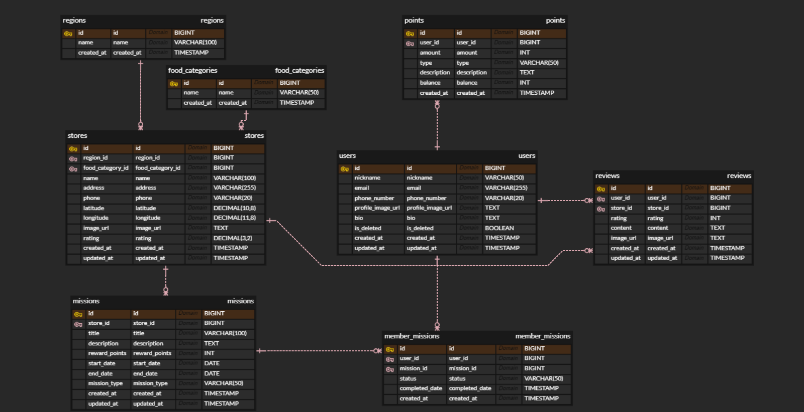

# 1주차 BE: 요구사항을 데이터로 바꾸기 (ERD)

> 한 줄 요약: **화면과 기능(요구사항)을 보고 "무엇을 저장해야 하는지"를 표와 관계로 그리는 게 ERD.** ERD는 그대로 `CREATE TABLE`(DDL)이 되어 실제 DB 뼈대가 된다.

## 1. 핵심 개념

| 개념 | 쉬운 설명 | 비유 |
|---|---|---|
| **RDB** | 데이터를 행·열로 된 **표(테이블)**에 저장하고 표끼리 관계를 맺는 DB (MySQL) | 엑셀 시트 여러 장을 연결 |
| **SQL** | RDB에 말 거는 언어. DDL(구조) / DML(데이터) | DB 공용어 |
| **NoSQL** | 표 대신 문서·키값 등으로 저장. 구조가 유연 | 자유 형식 메모장 |
| **엔티티(테이블)** | 저장할 대상 하나 (회원, 가게, 미션) | 서류철 하나 |
| **속성(컬럼)** | 엔티티의 정보 항목 (이름, 이메일) | 서류의 칸 |
| **PK** | 행을 하나로 콕 집는 값. 보통 `id BIGINT AUTO_INCREMENT` | 주민등록번호 |
| **FK** | 다른 테이블의 PK를 가리키는 컬럼. 관계를 만든다 | "소속: ○○팀" 표시 |
| **1:N** | 한 쪽 1개에 다른 쪽 여러 개 (지역 1 : 가게 N). **N 쪽에 FK** | 반 하나에 학생 여럿 |
| **N:M** | 양쪽 다 여러 개 (회원 ↔ 미션). **중간 테이블**로 1:N 두 개로 쪼갬 | 수강 신청 명단 |
| **NOT NULL** | 꼭 있어야 하는 값 | 필수 입력 칸 |
| **Soft Delete** | 행을 지우지 않고 `is_deleted = true`로 표시 | 휴지통 |
| **정규화** | 같은 정보를 여러 곳에 중복 저장하지 않게 표를 나누기 | 주소록은 한 곳에서만 관리 |

## 2. 미션: 로컬 맛집 미션 서비스 ERD

- ERD 이미지: [week01-erd/erd.png](../../week01-erd/erd.png)
- ERD → DDL: [week01-erd/schema.sql](../../week01-erd/schema.sql) (H2 MySQL 모드로 실행 확인)

| 테이블 | 역할 | 관계 |
|---|---|---|
| `users` | 회원 (Soft Delete) | 1:N `member_missions`, `reviews`, `points` |
| `regions` | 지역 | 1:N `stores` |
| `food_categories` | 음식 카테고리 | 1:N `stores` |
| `stores` | 가게 | 1:N `missions`, `reviews` |
| `missions` | 가게별 미션 (보상 포인트, 기간) | 1:N `member_missions` |
| `member_missions` | 회원이 도전한 미션 (진행 중 / 완료) | `users` N:M `missions`의 중간 테이블 |
| `reviews` | 가게 리뷰 | `users`, `stores` 참조 |
| `points` | 포인트 적립·사용 내역 | `users` 참조 |

### 필수 요구사항 → 반영
| 필수 화면 | 테이블 |
|---|---|
| 로그인 / 회원가입 | `users` |
| 홈, 지역·가게 정보 | `regions`, `stores`, `food_categories` |
| 미션 목록, 미션 수행 내역 | `missions`, `member_missions` |

## 3. 자주 하는 실수
- N:M을 FK 하나로 표현하려 하기 → 중간 테이블이 필요하다.
- FK를 1 쪽에 두기 → FK는 항상 **N 쪽**에 둔다 (`stores.region_id`).
- 모든 컬럼을 NULL 허용 → 필수값은 NOT NULL로 DB가 막아 주게 한다.
- ERD를 처음부터 완벽하게 만들려고 시간 쓰기 → 개발하면서 고쳐 나간다.

## 4. 스스로 점검하기

Q1. 회원과 미션이 N:M인 이유와 해결 방법은?

회원 한 명이 여러 미션에 도전하고, 미션 하나에도 여러 회원이 도전한다. `member_missions` 중간 테이블에 `user_id`, `mission_id` FK를 두어 1:N 두 개로 쪼갠다.

Q2. 회원 탈퇴를 Soft Delete로 하는 이유는?

리뷰·포인트 내역처럼 그 회원을 참조하는 데이터가 남아 있어서, 행을 지우면 FK가 깨지거나 기록이 사라진다.

